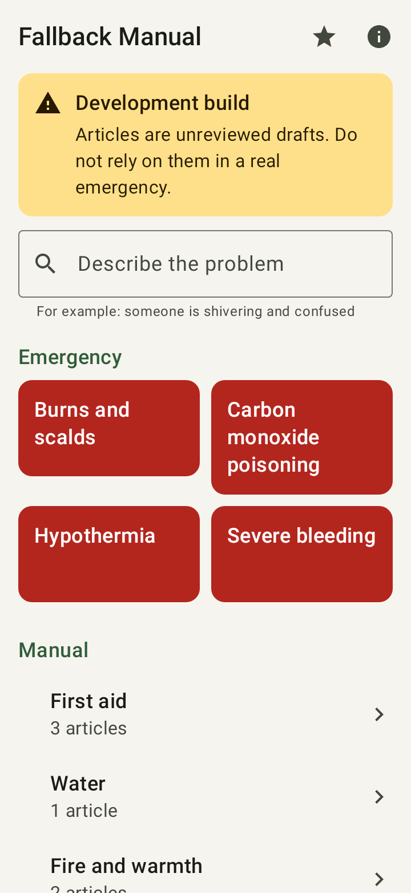
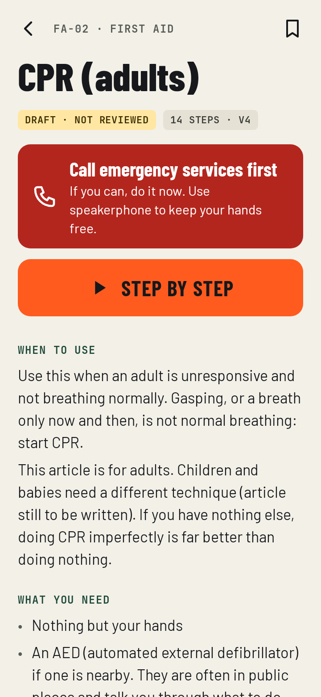
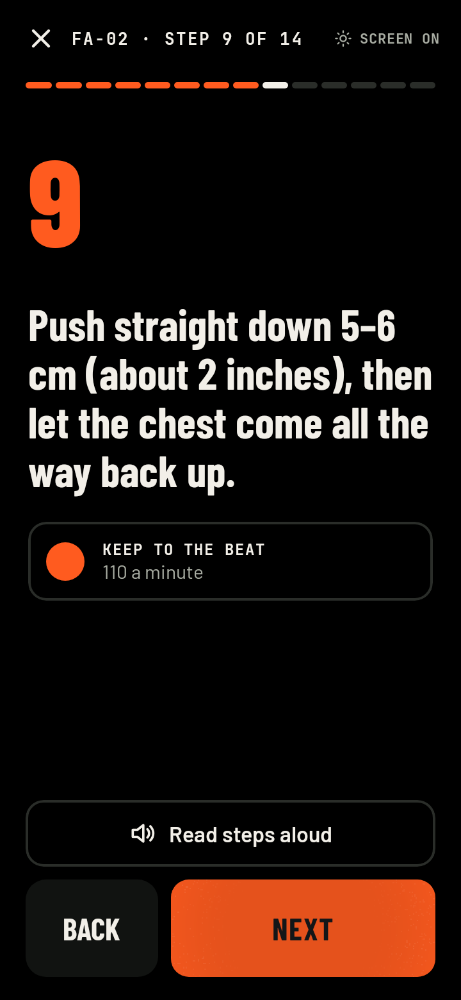
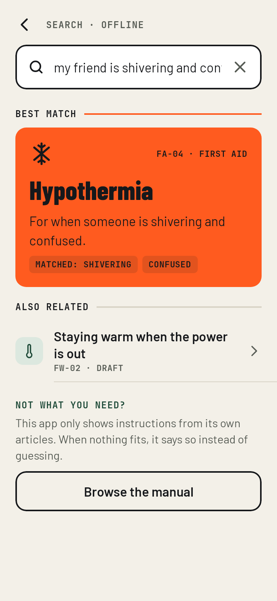
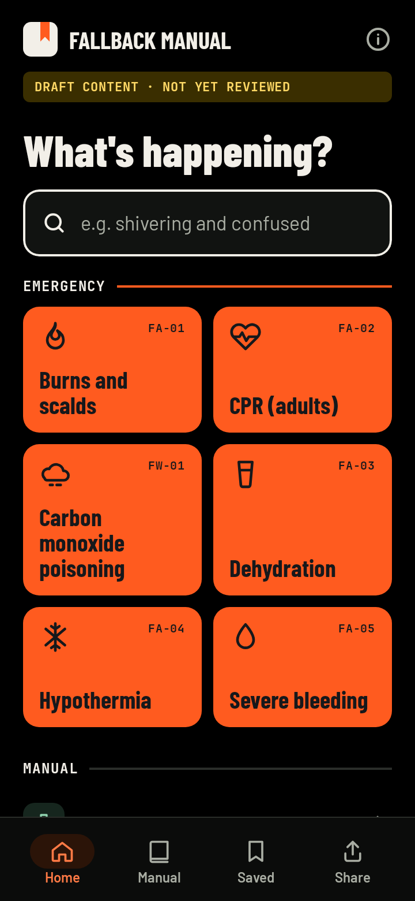

# Fallback Manual

*Knowledge when everything else fails.*

An open-source, fully offline emergency and survival reference for Android. A curated, reviewed and cited manual first, with an optional compact model ("Nano") that helps people find the right procedure in everyday language. Nano never writes the instructions; it only points to reviewed articles.

**Status:** Phase 1 started. Content pipeline, Layer 0 search, benchmark and a first Android app are working. The app has not yet been run on a real phone. **All articles are unreviewed drafts. Do not rely on them.**

- [Project proposal (Revision 2)](docs/PROPOSAL.md)
- [Article format and content status](knowledge/README.md)
- [Adding or editing articles (for people and AI agents)](AGENTS.md)

<p>
  
  
  
  
  
</p>

## Layout

```text
android/      Android app (Kotlin, Jetpack Compose)
  core/       database access and the Kotlin port of the search (plain JVM, unit-testable)
  app/        the app itself
knowledge/    articles (Markdown + YAML), synonyms, stop words, categories
tools/        build_kb.py: validates articles and compiles build/knowledge.db (+ knowledge-nb.db, ...)
retrieval/    search.py: Layer 0 search (FTS5 + synonyms + typo fixes + confidence)
evaluation/   benchmark questions and runner
tests/        pytest suite
```

## Quick start

Requires Python 3.11+.

```sh
pip install -r requirements-dev.txt

python -m tools.check                         # run every check; prints PASS or what to fix
python -m tools.new_article --list            # categories and existing articles
python -m tools.build_kb                      # build build/knowledge.db (drafts allowed)
python -m tools.build_kb --release            # fails unless every article is reviewed

python -m retrieval.search "someone is shivering and confused"
python -m evaluation.run_benchmark --failures
python -m pytest -q
```

## Android app

Requires JDK 17+, the Android SDK (platform 36) and Python 3 with PyYAML, because the build compiles `knowledge/` into the database it ships.

```sh
cd android
./gradlew :app:assembleDebug          # app/build/outputs/apk/debug/app-debug.apk
./gradlew :core:test                  # checks the Kotlin search returns exactly what the Python one does
./gradlew :app:testDebugUnitTest      # drives the app on the desktop (Robolectric) and saves docs/screenshots
./gradlew :app:assembleRelease        # fails while any article is unreviewed (by design)
./gradlew :app:assembleRelease -PallowDrafts=true   # release-type build with drafts, for testing only
```

What the app does today: step-by-step mode (one step at a time in very large text, screen kept on, read-aloud with the phone's offline voice, a beat guide for CPR compressions), emergency tiles for high-risk articles, browsing by category, articles with numbered steps, warnings, sources and review status, links between articles that open in a sheet over the current one (e.g. "start CPR" in the carbon monoxide article), natural-language search that says "no match" instead of guessing, saved articles, light and dark themes, offline sharing (below), and English and Norwegian Bokmål: the app's text and the articles follow the phone's language, with the English article shown wherever a translation is missing or out of date. It has no internet permission.

### Offline sharing

**Share this app** (the share icon on the home screen) passes the app, with the whole manual inside, to a nearby phone without internet:

- **Send:** opens the system share sheet with the app's own APK, so Quick Share / Nearby Share, Bluetooth or any other installed transport can carry it.
- **Send as ZIP:** the same file wrapped in a ZIP, for phones that refuse app files over Bluetooth.
- **Save a copy:** writes the APK to an SD card, USB stick or Downloads through the system file picker.
- An install guide for the receiving phone, and the app's **signing fingerprint** (also under About) so the receiver can check the copy is genuine.

It needs no permissions: an app can always read its own APK, and the receiving app only gets temporary read access to the one file sent. Copies installed from an app store as split APKs can't be passed on intact; the app detects this and says so.

The fingerprint check only means something once releases are signed with one stable key. Debug builds use each developer's own debug key, and release builds are currently unsigned.

Sizes: debug APK 17.5 MB; release APK 7.5 MB containing three CPU architectures (fonts included), roughly 4 MB per architecture if split.

Tested on one real phone (Samsung, Android, dark mode): the app starts, loads the bundled database and shows articles. Not yet tested on a real device: offline sharing between two phones, and older or low-end phones.

## Current benchmark (Layer 0 only)

9 draft articles, 57 questions, threshold 0.6:

| Set | Questions | Top-1 | Top-3 | Correct "no match" | Dangerous answers |
|---|---:|---:|---:|---:|---:|
| dev (tuned on) | 26 | 100% | 100% | 100% | 0 |
| held-out | 31 | 96% | 100% | 100% | 0 |

These numbers flatter the system: the library is tiny and the questions were written by the same author as the articles. They become meaningful once the library grows and outsiders write questions.
